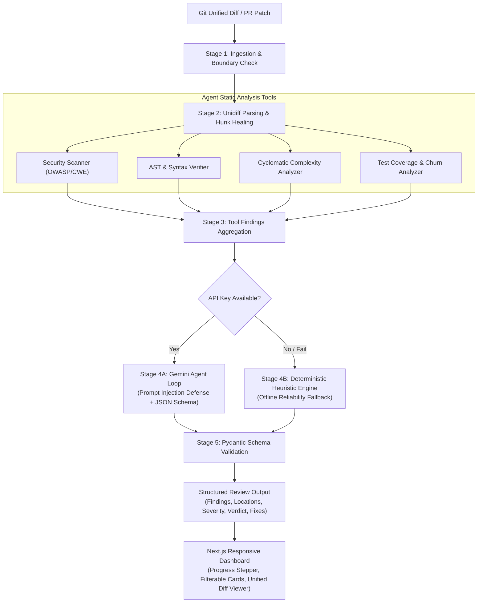

# DiffGuard — AI-Powered Git Diff & Pull Request Review Agent

DiffGuard is an enterprise-grade, agentic code review system designed to analyze Git unified diffs and pull request patches. Unlike simple chatbots that merely regurgitate code, DiffGuard implements a multi-stage **AI agent workflow**: it decomposes diff hunks, invokes deterministic empirical analysis tools (security scanning, AST syntax validation, complexity metrics, test gap analysis), and synthesizes validated, structured review findings with actionable fixes.

---

## Architecture Overview



---

## Key Features

1. **True AI Agent Workflow**:
   - **Empirical Tool Calling**: Deterministic tools execute on code hunks to extract empirical proof of bugs, vulnerabilities, and high complexity before AI synthesis.
   - **Structured Schema Enforced**: Powered by Pydantic v2 and Gemini JSON Schema constraints (`ReviewResponse`, `Finding`, `ReviewSummary`).
   - **Zero Failure Degradation**: Includes a deterministic heuristic engine that functions seamlessly even when the Gemini API is offline, unconfigured, or rate-limited.

2. **Core Review Capabilities**:
   - **Bugs & Logic Errors**: Off-by-one errors, missing awaits, unhandled promises, unhandled edge cases.
   - **Security & Reliability**: SQL injection risks, hardcoded private keys/secrets, OS command injection, unclosed file/resource leaks.
   - **Missing Test Coverage**: Flags modified production logic lacking corresponding unit or integration test updates.
   - **Code Quality & Maintainability**: Evaluates cyclomatic complexity and nesting depth to highlight high cognitive load code.
   - **Style & Consistency**: Flags dangerous bare excepts, loose equality, and non-idiomatic patterns.

3. **Security & Prompt Injection Defense**:
   - **Untrusted Input Isolation**: Code diffs are wrapped inside strict `<untrusted_git_diff>` boundaries with explicit agent instructions to reject prompt injection attempts embedded in code comments or strings.
   - **Sandboxed Analysis**: Submitted code is analyzed statically and is **never executed**.

4. **Modern Developer UI (Next.js + Tailwind CSS)**:
   - **Preloaded Realistic Scenarios**: 5 bundled sample diffs (Critical SQLi, Async Logic Bug, Resource Leak, Untested Complexity, Clean PR).
   - **Real-Time Stage Tracker**: Visual stepper with real-time SSE streaming of agent execution stages.
   - **Interactive Filtering & Search**: Filter by Severity (Critical, High, Medium, Low, Info), Category, and Confidence (Confirmed, Potential, Suggestion).
   - **Unified Diff Viewer**: Side-by-side / unified code viewer with line-level finding annotations.
   - **One-Click Export**: Export comprehensive code review reports in GitHub-flavored Markdown.

---

## Project Structure

```
Diffguard/
├── backend/
│   ├── app/
│   │   ├── api/
│   │   │   └── routes.py              # REST & SSE streaming endpoints (/api/review, /api/review/stream, /api/samples)
│   │   ├── agent/
│   │   │   ├── reviewer_agent.py      # Core agent orchestrator
│   │   │   ├── prompts.py             # System instructions & prompt injection defenses
│   │   │   └── fallback_engine.py     # Deterministic heuristic engine for 100% offline reliability
│   │   ├── models/
│   │   │   ├── schemas.py             # Pydantic domain models & response contracts
│   │   │   └── diff_models.py         # Internal unidiff representations
│   │   ├── parser/
│   │   │   └── diff_parser.py         # Resilient git diff parser with automated header healing
│   │   ├── samples/
│   │   │   └── sample_diffs.py        # 5 curated realistic test scenarios
│   │   ├── tools/
│   │   │   ├── security_scanner.py    # OWASP/CWE pattern detector (SQLi, secrets, cmd injection)
│   │   │   ├── syntax_checker.py      # AST & JS anomaly analyzer
│   │   │   ├── complexity_analyzer.py # Cyclomatic complexity & nesting depth metric tool
│   │   │   ├── test_requirement_analyzer.py # Production vs test churn validator
│   │   │   └── tool_registry.py       # Tool execution dispatcher & Gemini tool schemas
│   │   ├── config.py                  # Pydantic application settings
│   │   └── main.py                    # FastAPI application entrypoint & CORS middleware
│   ├── tests/                         # 26 Unit & Integration Tests (100% passing)
│   │   ├── test_diff_parser.py
│   │   ├── test_tools.py
│   │   ├── test_agent_schema.py
│   │   ├── test_api_routes.py
│   │   └── test_security_adversarial.py
│   ├── requirements.txt
│   └── pytest.ini
├── frontend/
│   ├── src/
│   │   ├── app/
│   │   │   ├── page.tsx               # Main review dashboard & state machine
│   │   │   ├── layout.tsx             # Root layout with dark theme
│   │   │   └── globals.css            # Tailwind utilities & custom diff highlights
│   │   ├── components/
│   │   │   ├── Navbar.tsx             # App header with model status and settings trigger
│   │   │   ├── DiffInput.tsx          # Textarea editor, sample picker, and patch uploader
│   │   │   ├── ProgressStages.tsx     # Live agent execution pipeline stepper
│   │   │   ├── SummaryCards.tsx       # Verdict badge, key takeaways, and metric stats
│   │   │   ├── FindingsList.tsx       # Filterable & searchable findings container
│   │   │   ├── FindingCard.tsx        # Structured finding card with root cause, impact, & fix
│   │   │   ├── DiffViewer.tsx         # Unified diff view with line annotations
│   │   │   └── SettingsModal.tsx      # Browser-level Gemini API key & model configuration
│   │   └── types/
│   │       └── index.ts               # TypeScript interfaces matching backend models
│   ├── package.json
│   ├── tsconfig.json
│   └── tailwind.config.js
├── README.md
└── .env.example
```

---

## Quickstart Guide

### Prerequisites
- Python 3.12+
- Node.js 18+ and npm

### 1. Backend Setup

```bash
cd backend

# Create virtual environment (optional but recommended)
python -m venv venv
# Windows:
.\venv\Scripts\activate
# Linux/macOS:
source venv/bin/activate

# Install dependencies
pip install -r requirements.txt

# (Optional) Set your Gemini API key in .env or environment
# If unset, DiffGuard will seamlessly run its deterministic heuristic review engine
set GEMINI_API_KEY=your_gemini_api_key

# Run backend API server
uvicorn app.main:app --host 0.0.0.0 --port 8000 --reload
```

Backend API will be running at `http://127.0.0.1:8000`.  
Interactive OpenAPI documentation is available at `http://127.0.0.1:8000/docs`.

### 2. Running Backend Tests

```bash
cd backend
python -m pytest tests -v
```

All **26 unit, integration, and security adversarial tests** pass cleanly.

### 3. Frontend Setup

```bash
cd frontend

# Install dependencies
npm install

# Run Next.js development server
npm run dev
```

Open `http://localhost:3000` in your browser.

---

## API Reference

### 1. `POST /api/review`
Synchronous review endpoint that processes diff and returns complete structured response.

**Request:**
```json
{
  "diff_content": "diff --git a/services/auth.py b/services/auth.py...",
  "title": "Fix authentication query",
  "custom_instructions": "Check for SQL injection and token leaks"
}
```

**Response:**
```json
{
  "review_id": "rev_1710000000",
  "timestamp": "2026-11-13T19:00:00Z",
  "parsed_files_count": 1,
  "total_additions": 10,
  "total_deletions": 3,
  "summary": {
    "total_findings": 2,
    "by_severity": { "CRITICAL": 1, "HIGH": 1 },
    "verdict": "CRITICAL_BLOCKER",
    "key_takeaways": ["Blocked by 1 Critical issue(s) that must be remediated immediately."]
  },
  "findings": [
    {
      "id": "DG-001",
      "title": "SQL Injection Risk (CWE-89)",
      "category": "SECURITY_AND_RELIABILITY",
      "severity": "CRITICAL",
      "confidence": "CONFIRMED_ISSUE",
      "location": {
        "file_path": "services/auth_service.py",
        "start_line": 23,
        "code_context": "raw_query = f\"SELECT * FROM users WHERE email = '{email}'\""
      },
      "why_identified": "SQL query constructed via f-string without parameterized binding.",
      "impact": "Allows arbitrary SQL injection leading to total database compromise.",
      "suggested_fix": {
        "description": "Use parameterized queries.",
        "replacement_code": "cursor.execute('SELECT * FROM users WHERE email = %s', (email,))"
      },
      "tool_evidence": ["Rule ID: SEC-SQLI-001", "CWE: CWE-89"]
    }
  ],
  "stages_executed": [...],
  "engine_used": "gemini-agent (gemini-2.5-flash)"
}
```

### 2. `POST /api/review/stream`
Server-Sent Events (SSE) streaming endpoint that yields real-time `stage_update` events as each processing phase begins and completes, terminating with the final `completed` review payload.

### 3. `GET /api/samples`
Returns bundled sample diff scenarios with descriptions and expected findings.

### 4. `GET /api/health`
Diagnostics endpoint reporting service status, active engine, and configuration.

---

## Bundled Sample Scenarios

| Sample ID | Title | Highlighted Risk | Expected Severity |
| :--- | :--- | :--- | :--- |
| `sample-sqli-auth` | Auth Service SQL Injection & Token Leak | Raw SQL formatting + Hardcoded JWT secret | **CRITICAL** |
| `sample-logic-async-bug` | Payment Batch Loop & Missing Await | Off-by-one `range(len+1)` + Unawaited async call | **CRITICAL** |
| `sample-resource-leak` | File Descriptor Leak & Bare Except | Naked `open()` assignment + `except Exception: pass` | **HIGH** |
| `sample-untested-complexity` | Rebate Pricing Engine Without Tests | High cyclomatic complexity + 0 test changes | **HIGH** |
| `sample-clean-pr` | Production-Ready Rate Limiter | Thread-safe, typed, with comprehensive unit tests | **APPROVED** |

---

## Verification and Quality Standard

- **Clean Architecture**: Separates models, parsing, static analysis tools, agent reasoning, and presentation.
- **Fail-Safe Reliability**: When an external API or key is absent, DiffGuard falls back seamlessly to deterministic heuristics without interrupting user experience.
- **Prompt Injection Defense**: Evaluated against adversarial prompt injections designed to manipulate verdicts.
- **Type Safety**: Strictly enforced with Pydantic v2 in Python and TypeScript in Next.js.
