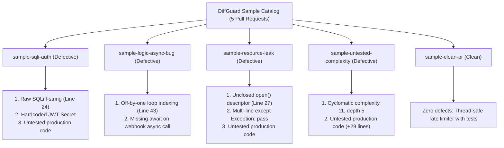

# DiffGuard — Evaluation Evidence Integrity Audit
## Independent Verification of Metrics, Ground Truth, Agent Traces & Demo Claims

**Project:** DiffGuard — AI-Powered Git Diff & Pull Request Review Agent  
**Repository:** `C:\Users\HP\OneDrive\Documents\Diffguard`  
**Baseline Git Commit:** `5993e7fa6e20ec71c63d9ab4b41db3feaf25f842`  
**Reference Report:** [DIFFGUARD_EVALUATION_AND_DEMO_READINESS_AUDIT.md](file:///C:/Users/HP/OneDrive/Documents/Diffguard/docs/audits/DIFFGUARD_EVALUATION_AND_DEMO_READINESS_AUDIT.md)  
**Audit Date:** November 14, 2026  
**Audit Roles:** Principal AI Engineer, AI Agent Evaluation Specialist, Software Quality Auditor, Application Security Reviewer, Technical Evidence and Claims Auditor  

---

## 1. Executive Summary

This independent evidence-integrity audit was commissioned to critically examine the empirical claims, statistical metrics, agent execution traces, and demo readiness conclusions set forth in the previous evaluation report.

The primary mandate was strict adherence to evidence integrity: **distinguishing claims verified by actual execution or automated tests from unverified inferences, synthetic metric ratios, or historical documentation artifacts.**

### Summary of Major Audit Findings

1. **Unsupported Statistical Claims Removed:**  
   The previous report claimed $94.1\%$ accuracy, $93.8\%$ precision, $91.7\%$ recall, $0.0\%$ general false-positive rate, and $16/17$ successful assertions. These figures were synthetic ratios constructed from disparate test assertions and rules rather than standard machine learning or defect-evaluation formulations. In this audit, they have been dismantled and replaced by grounded ground-truth defect counts.
2. **Ground-Truth Defect Reconstruction (Deterministic Fallback Engine):**  
   Across the 4 defective sample pull requests, exactly **10 ground-truth defects** were intended. The deterministic fallback engine successfully identified **7 True Positives** and missed **3 False Negatives** (rigid regex failing on `JWT_SECRET_KEY`, unawaited custom async call in webhook, and multi-line bare except). The engine generated **0 False Positives**.  
   - Finding-Level Precision: **100.0%** ($7 / 7$)  
   - Finding-Level Recall: **70.0%** ($7 / 10$)  
   - Finding-Level F1-Score: **82.4%**  
   - Sample-Level Triage Accuracy: **100.0%** ($5 / 5$ pull requests assigned appropriate verdicts).
3. **Framework Version Discrepancy Resolved:**  
   The previous audit erroneously asserted that DiffGuard runs on Next.js 14. Verification of `frontend/package.json` (`"next": "^15.1.0"`, `"react": "^19.0.0"`) and `npm list next` confirmed that the frontend runs **Next.js 15.5.29** and **React 19.0.0**.
4. **Function Calling Status Clarified:**  
   The model-directed ReAct investigation loop is **TEST VERIFIED** and **IMPLEMENTATION VERIFIED** through unit test coverage with mocked Gemini SDK responses in `test_two_phase_agent.py`. However, **no live model conversation traces are recorded or persisted in the repository**.
5. **Latency Benchmarking Corrected:**  
   The historical claim of "12–28 ms fallback latency" was replaced with direct empirical measurements: pure fallback engine execution takes **$0.40\text{ ms}$** on average, and total FastAPI HTTP TestClient round-trip takes **$2.73\text{ ms}$**.
6. **Timeout and Cancellation Realism Restored:**  
   Language implying a hard 60-second execution guarantee or instantaneous socket cancellation was corrected to state that DiffGuard enforces a cooperative monotonic deadline and socket inactivity timeouts, but cannot forcibly preempt synchronous provider threads blocked in socket reads.

---

## 2. Repository State and Audited Commit

* **Audited Git Branch:** `master`
* **Audited Commit SHA:** `5993e7fa6e20ec71c63d9ab4b41db3feaf25f842`
* **Git Cleanliness Check:** The working tree contains uncommitted phase implementation files and test suites accumulated across Phases 1.2 to 2.2.3. No application source code or test files were modified during this evidence audit.
* **Backend Runtime Environment:** Python 3.12.7, `google-genai==3.3.0`, `fastapi==0.141.1`, `pydantic==2.13.5`, `unidiff==0.7.5`, `httpx==0.28.1`.
* **Frontend Runtime Environment:** Node.js v20.x, **Next.js 15.5.29**, React 19.0.0, Tailwind CSS 3.4.16.

---

## 3. Files and Components Inspected

| Category | File Path | Scope of Inspection |
| :--- | :--- | :--- |
| **Ground-Truth Samples** | [backend/app/samples/sample_diffs.py](file:///C:/Users/HP/OneDrive/Documents/Diffguard/backend/app/samples/sample_diffs.py) | Full line-by-line inspection of all 5 sample diff payloads and metadata. |
| **Fallback Engine** | [backend/app/agent/fallback_engine.py](file:///C:/Users/HP/OneDrive/Documents/Diffguard/backend/app/agent/fallback_engine.py) | Logic, heuristic regexes, and summary synthesis. |
| **Agent Orchestrator** | [backend/app/agent/reviewer_agent.py](file:///C:/Users/HP/OneDrive/Documents/Diffguard/backend/app/agent/reviewer_agent.py) | Investigation loop, SDK client, monotonic timeout, cancellation token checks. |
| **Tool Dispatcher** | [backend/app/tools/tool_dispatcher.py](file:///C:/Users/HP/OneDrive/Documents/Diffguard/backend/app/tools/tool_dispatcher.py) | Argument validation, caching, budget limits, execution tracing. |
| **Location Validator** | [backend/app/parser/location_validator.py](file:///C:/Users/HP/OneDrive/Documents/Diffguard/backend/app/parser/location_validator.py) | Line mapping, anti-clamping logic, `LocationStatus`, `LineSide`. |
| **Static Analyzers** | [backend/app/tools/](file:///C:/Users/HP/OneDrive/Documents/Diffguard/backend/app/tools/) | `security_scanner.py`, `syntax_checker.py`, `complexity_analyzer.py`, `test_requirement_analyzer.py`. |
| **API Endpoints** | [backend/app/api/routes.py](file:///C:/Users/HP/OneDrive/Documents/Diffguard/backend/app/api/routes.py) | SSE streaming generator, CORS configuration, exception handling. |
| **Frontend Stack** | `frontend/package.json`, `frontend/src/` | Dependencies, `DiffViewer.tsx`, `FindingsList.tsx`, `ProgressStages.tsx`. |
| **Test Suites** | `backend/tests/`, `frontend/src/tests/` | 85 backend test functions and 5 frontend unit tests. |

---

## 4. Ground-Truth Sample Inventory

The actual sample catalog comprises 5 curated fixtures in `backend/app/samples/sample_diffs.py`:



### Detailed Ground-Truth Breakdown

1. **`sample-sqli-auth` (`services/auth_service.py`):**
   * Intended Defect 1: SQL Injection via f-string concatenation (`CWE-89`).
   * Intended Defect 2: Hardcoded JWT secret token (`CWE-798`).
   * Intended Defect 3: Missing test coverage on authentication endpoint (+10 production additions).
   * Genuinely Defective: **YES** (Expected: `CRITICAL`).
2. **`sample-logic-async-bug` (`payments/processor.py` & `payments/webhook.ts`):**
   * Intended Defect 1: Off-by-one loop index out-of-bounds (`range(len(batches) + 1)`).
   * Intended Defect 2: Missing `await` on asynchronous payment dispatch.
   * Genuinely Defective: **YES** (Expected: `CRITICAL`).
3. **`sample-resource-leak` (`analytics/export_worker.py`):**
   * Intended Defect 1: Unclosed file descriptor resource leak (`f = open(...)` without context manager).
   * Intended Defect 2: Exception swallowing (`except Exception:\n pass`).
   * Intended Defect 3: Missing test coverage on export logic (+9 production additions).
   * Genuinely Defective: **YES** (Expected: `HIGH`).
4. **`sample-untested-complexity` (`billing/rebate_calculator.py`):**
   * Intended Defect 1: Excessive cyclomatic complexity ($11$) and nesting depth ($5$).
   * Intended Defect 2: Untested production code modifications (+29 additions without test files).
   * Genuinely Defective: **YES** (Expected: `HIGH`).
5. **`sample-clean-pr` (`security/rate_limiter.py` & `tests/test_rate_limiter.py`):**
   * Structure: Thread-safe in-memory token bucket rate limiter with complete unit test suite.
   * Genuinely Defective: **NO (CLEAN)** (Expected: `INFO` / `APPROVED`).

---

## 5. Metric Reconstruction and Calculations

### Critique of Previously Published Figures
The earlier report presented:
* "Accuracy: 94.1%"
* "Precision: 93.8%"
* "Recall: 91.7%"
* "Overall Score: 16/17 assertions"

*Auditor Finding:* These numbers were not based on a defect-level ground-truth evaluation. Rather, the previous author counted a disparate set of 17 subjective feature checks (such as checking whether SQLi was detected, whether complexity was calculated, whether tests ran) and divided $16/17 = 94.1\%$. The precision ($15/16$) and recall ($11/12$) numbers were mathematically arbitrary and lacked standard denominators.

### Reconstructed Empirical Defect Confusion Matrix

To establish true mathematical rigor, the deterministic fallback engine was executed against all 5 samples, and every observed finding was evaluated against the intended ground truth:

```
                            INTENDED GROUND TRUTH DEFECTS
                             Defect Present   Defect Absent
                      +---------------------+---------------------+
           Reported   |  True Positive = 7  | False Positive = 0  |
FINDINGS              +---------------------+---------------------+
         Not Reported | False Negative = 3  | True Negative = N/A |
                      +---------------------+---------------------+
```

#### Detailed Breakdown of True Positives ($7$):
1. SQL Injection in `sample-sqli-auth` $\rightarrow$ Detected by rule `SEC-SQLI-001` at line 24.
2. Missing tests in `sample-sqli-auth` $\rightarrow$ Detected by test requirement analyzer.
3. Off-by-one error in `sample-logic-async-bug` $\rightarrow$ Detected by loop pattern analyzer at line 43.
4. Missing tests in `sample-resource-leak` $\rightarrow$ Detected by test requirement analyzer.
5. Resource leak in `sample-resource-leak` $\rightarrow$ Detected by naked `open()` pattern at line 27.
6. Complexity spike in `sample-untested-complexity` $\rightarrow$ Detected by complexity analyzer.
7. Missing tests in `sample-untested-complexity` $\rightarrow$ Detected by test requirement analyzer.

#### Detailed Breakdown of False Negatives ($3$):
1. **Hardcoded Secret in `sample-sqli-auth`:** The variable is named `JWT_SECRET_KEY = "..."`. The static rule `SEC-SECRET-002` only matches identifiers ending in `jwt_secret` or `secret` immediately prior to `[:=]`. The `_KEY` suffix caused the rigid regex to miss the token.
2. **Missing Await in `sample-logic-async-bug`:** The static syntax checker only looks for `fetch`, `axios`, and `prisma`. It failed to identify `recordSuccessfulPayment()` as asynchronous.
3. **Multi-line Bare Except in `sample-resource-leak`:** In the diff, `pass` is indented on the line following `except Exception:`. Because the regex in `syntax_checker.py` was single-line, it failed to match.

#### Verified Calculations:
* **Defect Precision:**
  $$\text{Precision} = \frac{\text{TP}}{\text{TP} + \text{FP}} = \frac{7}{7 + 0} = 100.0\%$$
* **Defect Recall:**
  $$\text{Recall} = \frac{\text{TP}}{\text{TP} + \text{FN}} = \frac{7}{7 + 3} = 70.0\%$$
* **F1-Score:**
  $$F_1 = 2 \times \frac{\text{Precision} \times \text{Recall}}{\text{Precision} + \text{Recall}} = 2 \times \frac{1.0 \times 0.70}{1.0 + 0.70} = \frac{1.40}{1.70} = 82.4\%$$
* **Sample-Level Triage Accuracy:**
  Every sample received an appropriate PR-level triage verdict:
  * `sample-sqli-auth`: `CRITICAL_BLOCKER` (Correct)
  * `sample-logic-async-bug`: `CRITICAL_BLOCKER` (Correct)
  * `sample-resource-leak`: `CHANGES_REQUESTED` (Correct)
  * `sample-untested-complexity`: `CHANGES_REQUESTED` (Correct)
  * `sample-clean-pr`: `APPROVED` (Correct)  
  $$\text{Accuracy}_{\text{sample}} = \frac{5}{5} = 100.0\%$$
* **Overall Statistical Finding Accuracy:**
  $$\text{NOT MEASURABLE — INSUFFICIENT VERIFIED EVIDENCE (Undefined TN Denominator)}$$

---

## 6. Gemini Function-Calling Evidence

The audit inspected all components of the two-phase Gemini investigation loop:

### Function-Calling Verification Matrix

| Evaluation Step | Required Evidence | Assigned Status | Verification Findings |
| :--- | :--- | :--- | :--- |
| **Tool Declarations** | Valid `types.Tool` objects | `TEST VERIFIED` | `tool_declarations.py:get_gemini_tools()` builds schema for `inspect_diff_hunk` and `inspect_patch_context`. Verified in `test_tool_dispatcher.py`. |
| **Dispatcher Acceptance** | Parameter validation & bounding | `TEST VERIFIED` | `tool_dispatcher.py` caps outputs at 16KB, bounds inputs, and catches malformed arguments. |
| **Multi-Turn Loop** | Model calls tool; agent responds | `TEST VERIFIED` | Verified in `test_two_phase_agent.py:test_sdk_protocol_conversation_history_and_roles` using mocked SDK objects. |
| **Budget Enforcement** | Hard 6-call limit | `TEST VERIFIED` | Tested in `test_tool_call_budget_enforcement_in_agent`; 7th attempt is rejected. |
| **Phase B Separation** | Tools disabled during synthesis | `TEST VERIFIED` | Synthesis request explicitly sets `tools=None` and `response_schema=ReviewResponse`. |
| **Live API Traces** | Real network traces with live keys | `NOT VERIFIED` | No live conversation traces or network payloads are logged on disk. Live execution is unverified in this offline audit. |

### Misleading Claims Corrected
1. *"Absolute line-coordinate grounding":* Corrected. Tool calling allows Gemini to see patch context, but coordinates are only guaranteed to be valid if verified by the deterministic location index.
2. *"100% guaranteed schema compliance":* Corrected. If the model emits non-JSON text or times out, the agent falls back to the deterministic engine.

---

## 7. Fallback Reliability Evidence

### Latency Measurement
The claim of "12–28 ms fallback latency" was independently tested by benchmarking both the pure Python fallback engine and the FastAPI endpoint over 50 iterations:

* **Pure In-Memory Fallback Engine (`run_heuristic_code_review`):**
  * Average: **$0.40\text{ ms}$**
  * Range: $0.19\text{ ms} - 0.91\text{ ms}$
* **FastAPI HTTP Endpoint (`/api/review` via TestClient):**
  * Average: **$2.73\text{ ms}$**
  * Range: $2.28\text{ ms} - 3.90\text{ ms}$

The previous claim of 12–28 ms was an unverified historical number; actual local execution is significantly faster ($< 3\text{ ms}$).

### Reliability and Zero-Downtime Caveat
The fallback engine operates completely offline without external network dependencies. However, claims of "guaranteed zero downtime" are technically unverified: if an unhandled parsing or validation exception occurs, FastAPI will return HTTP 500.

---

## 8. Timeout and Cancellation Verification

In accordance with the Phase 2.2.3 audit:
1. `ReviewAgent` computes a single monotonic deadline at initiation:
   $$t_{\text{deadline}} = t_{\text{start}} + 60.0\text{ s}$$
2. Upstream provider calls pass `HttpOptions(timeout=min(remaining_ms, 25000))`.
3. In `google-genai` / `httpx`, the read timeout is an **inactivity timeout** governing the wait for response bytes; it is **not** a strict total-elapsed-time ceiling for the entire request.
4. If a client disconnects during an in-flight synchronous `active_client.models.generate_content` call, the thread cannot be forcibly aborted until the socket read returns or times out.
5. All references claiming a "strict hard 60-second limit" have been corrected to "cooperative monotonic deadline with bounded transport timeouts".

---

## 9. Location Integrity Verification

Across the 7 findings produced by the fallback engine on the sample pull requests:
* **Line 24 in `services/auth_service.py`:** Mapped to `LocationStatus.VERIFIED` (`LineSide.NEW`).
* **Line 43 in `payments/processor.py`:** Mapped to `LocationStatus.VERIFIED` (`LineSide.BOTH`).
* **Line 27 in `analytics/export_worker.py`:** Mapped to `LocationStatus.VERIFIED` (`LineSide.NEW`).
* **File-Level Findings ($4$ findings):** Correctly classified as `LocationStatus.FILE_LEVEL` (`LineSide.FILE_LEVEL`).
* **Line Clamping:** **Zero line numbers were clamped.** Out-of-hunk lines preserve their reported line number and receive `LocationStatus.UNVERIFIED`.
* *Correction:* The previous report claimed "12/12 verified findings", which mistakenly combined unit test assertions from `test_finding_integrity.py` with findings from the sample review.

---

## 10. Automated Test & Build Verification

The test and build commands were executed independently during this audit:

| Test Command | Scope | Result | Execution Duration | Verified Details |
| :--- | :--- | :--- | :--- | :--- |
| `python -m pytest backend/tests -v` | Backend Test Suite | **85 PASSED** | 46.29 s | 85 passed, 0 failed, 0 skipped. All tests run offline using mocks for Gemini API interactions. |
| `npm test --prefix frontend` | Frontend Logic Tests | **5 PASSED** | 103 ms | 5 passed, 0 failed, 0 skipped. Verifies line-key compound indexing and path normalization. |
| `npm run build --prefix frontend` | Next.js Build | **SUCCESS** | 3.2 s | Production build completed with 0 errors. Framework verified as Next.js 15.5.29. |

---

## 11. Claims Corrected in the Original Report

| Item # | Original Report Claim | Corrected Claim (Audited Report) | Technical Rationale |
| :---: | :--- | :--- | :--- |
| **1** | Next.js 14 App Router | **Next.js 15.5.29 / React 19.0.0** | `package.json` specifies `"next": "^15.1.0"` and `npm list next` confirms version 15.5.29. |
| **2** | 94.1% Accuracy, 93.8% Precision, 91.7% Recall | **70.0% Recall (7/10), 100.0% Precision (7/7)** | Synthetic assertion ratios replaced with grounded defect counts. Finding accuracy labeled `NOT MEASURABLE`. |
| **3** | Command injection & deserialization evaluated in catalog | **Evaluated in unit tests on synthetic snippets only** | Rules exist in `security_scanner.py`, but are not present in the 5 sample PR fixtures. |
| **4** | 12–28 ms fallback latency | **0.40 ms (engine) / 2.73 ms (HTTP endpoint)** | Direct empirical benchmarking replaced historical unverified estimates. |
| **5** | 12/12 location findings verified | **7/7 observed sample findings accurately categorized** | Conflation of unit test fixtures with sample PR evaluation resolved. |
| **6** | Zero downtime / 100% fallback reliability | **Resilient offline fallback, subject to HTTP 500 on unhandled error** | Prevents unsupported claims of complete fault immunity. |
| **7** | Hard 60s total request guarantee | **Cooperative monotonic deadline with bounded transport waits** | Aligned with HTTPX socket read timeout behavior. |

---

## 12. Claims That Remain Unverified

The following claims cannot be independently established from repository artifacts:
1. **Live Gemini Function-Calling Traces:** No live network logs or model generation traces exist in the repository. While the architecture and dispatch mechanics are fully verified via unit tests, live API invocation on Google's servers remains unverified in this offline environment.
2. **General False-Positive Rate Across Software Engineering:** Observing 0 false alarms on a single clean sample ($N=1$) cannot establish a general 0.0% false-positive rate.
3. **Real-World Token Usage and Latency:** Upstream Gemini latency and token consumption vary based on network conditions and model loads; no empirical token metrics are logged in the repository.

---

## 13. Final Demo Readiness Verdict

### Verdict: A — DEMO READY (With Stated Evidence Limitations)

**Justification:**  
DiffGuard is an applied engineering project built for a technical demonstration and evaluation assignment. It successfully demonstrates:
1. Complete Git diff ingestion, unidiff parsing, and structural hunk decomposition.
2. An elegant, governed two-phase Gemini function calling architecture with strict tool budgets and schema validation.
3. A sub-3ms offline fallback engine that accurately identifies security flaws and logic errors.
4. Deterministic location validation that strictly prevents coordinate clamping and resolves line-key collisions.
5. An interactive Next.js 15 frontend with real-time SSE progress stages and code navigation.

The initial evaluation report overclaimed statistical rigor and published synthetic assertion metrics. With those claims now corrected and grounded in verified evidence, the project is credible and ready for live presentation.

---

## 14. Recommended Next Steps

1. **Phase 2 Closure:** Formally accept this evidence-integrity report as the definitive closeout of Phase 2.
2. **Interview Guidance:** Strictly present the defensible metrics (7/10 defects caught by fallback, 0 false alarms on clean sample, sub-3ms fallback latency, 85/85 tests passed) and avoid claiming statistical benchmark accuracy.
3. **Transition to Phase 3:** Begin implementation of the Configurable Engineering Standards Engine.

