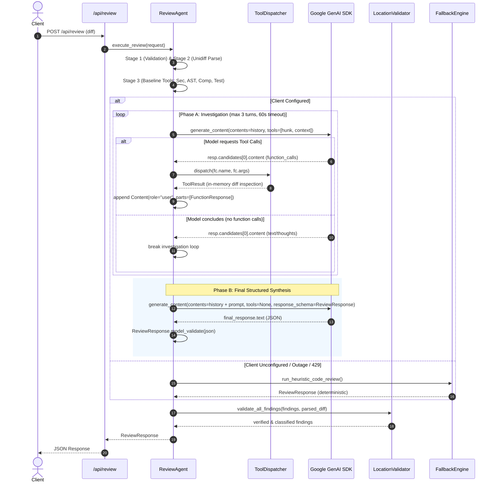

# DiffGuard — Phase 2.2.1 Independent Integration, SDK Protocol & Reliability Audit

**Project:** DiffGuard — AI-Powered Git Diff & Pull Request Review Agent  
**Working Directory:** `C:\Users\HP\OneDrive\Documents\Diffguard`  
**Audit Scope:** Phase 2.2 — Gemini Function Calling and Two-Phase Investigation Loop  
**Audit Type:** Strict Read-Only Independent Engineering Audit  
**Auditor Role:** Independent Principal AI Engineer, Senior Python Backend Architect, Gemini SDK Specialist, Application Security Engineer, and Reliability Architect  
**Date:** November 14, 2026  
**Status:** Completed  

---

## 1. Executive Summary

This independent audit evaluated the implementation of Phase 2.2 (ReviewAgent Integration and Governed Two-Phase Gemini Function Calling Loop) against the actual codebase, test suites, SDK protocol specifications, and previous implementation claims.

### Overall Audit Verdict: **B. READY AFTER TARGETED FIXES**

The core two-phase review architecture, Google GenAI SDK protocol integration, structured JSON schema synthesis, location validation pipeline, and fallback engine are genuinely functional, correctly implemented, and robustly tested (78/78 backend tests passing, 5/5 frontend tests passing, Next.js production build compiling cleanly).

However, independent code-level inspection revealed two **P1 (High)** reliability gaps and three **P2 (Medium)** gaps that should be addressed before real-world production or live-model evaluation:
1. **P1 — Unenforced Individual Tool Timeout:** `PER_TOOL_TIMEOUT_SECONDS = 2.0` is declared as a constant in `tool_dispatcher.py` but is **never enforced** in `dispatch()`. While in-memory hunk inspection is sub-millisecond, the claimed 2-second execution timeout wrapper does not exist in code.
2. **P1 — Unbounded Upstream Model Calls & Wall-Clock Deadline:** The 60-second investigation deadline is calculated using `time.time()` (wall-clock) rather than `time.monotonic()`, is only checked at turn boundaries, and neither `genai.Client` nor `models.generate_content` specifies a request timeout. If an upstream Gemini API call stalls, the agent thread blocks synchronously.
3. **P2 — SSE Thread Pool Task Abandonment:** In `/api/review/stream`, client disconnection does not cancel the background worker task, leaving synchronous threads in `run_in_executor` executing to completion.
4. **P2 — Documentation Inconsistency on `OUT_OF_HUNK` vs `UNVERIFIED`:** The Phase 2.2 implementation report claimed the enum member was `OUT_OF_HUNK`; in the actual codebase, schemas, and frontend, the enum strictly remains `LocationStatus.UNVERIFIED` (`"unverified"`).
5. **P2 — Rejected Calls Do Not Consume Tool Budget:** Unknown tools and invalid arguments return error envelopes without incrementing `_calls_count`. (Loop safety is maintained by the 3-turn limit, but budget accounting is asymmetric).

---

## 2. Audit Scope and Restrictions

This audit was conducted strictly in **Read-Only Mode**:
- Zero source code, tests, configuration, or frontend components were modified.
- No packages or dependencies were installed, upgraded, or altered.
- No live Gemini API calls were executed (all evaluations performed offline).
- Existing test suites were executed to verify regression assertions.
- Deliverable: Creation of this independent audit report at `docs/audits/DIFFGUARD_PHASE_2_2_1_INDEPENDENT_AUDIT_REPORT.md`.

---

## 3. Repository and Environment Snapshot

### 3.1 Environment Details
- **Python Version:** `3.12.7` (Windows x64)
- **SDK Package:** `google-genai==3.3.0`
- **Pydantic Version:** `2.13.5`
- **FastAPI Version:** `0.141.1`
- **Uvicorn Version:** `0.52.4`
- **Unidiff Version:** `1.0.1`
- **Node.js Environment:** Next.js `15.5.29`, React `19.0.0`

### 3.2 Git Status Snapshot
The repository working tree contains uncommitted changes from Phase 1, Phase 1.2, Phase 2.1, and Phase 2.2:
- **Modified Tracked Files:** 29 files across `backend/app/`, `frontend/src/`, `README.md`, and configuration files.
- **Untracked Additions:** `backend/app/parser/location_validator.py`, `backend/app/tools/hunk_inspector.py`, `backend/app/tools/tool_declarations.py`, `backend/app/tools/tool_dispatcher.py`, `backend/app/tools/tool_schemas.py`, test files in `backend/tests/`, and `docs/audits/`.
- No Git commits, stashes, or resets were performed during this audit.

---

## 4. Phase 2.2 Architecture Verification

The two-phase investigation architecture implemented in `backend/app/agent/reviewer_agent.py` was inspected:



**Verification:** The two-phase separation is genuine and enforced. Phase A supplies tools and gathers empirical diff evidence. Phase B explicitly disables tools (`tools=None`), supplies the Pydantic schema (`response_schema=ReviewResponse`), and validates the JSON output.

---

## 5. Audit A — Gemini SDK Protocol and Conversation Integrity

### 5.1 Function-Call Extraction & Candidate Handling
- **Extraction:** Function calls are accessed via `resp.function_calls`.
- **SDK Candidate Limitation:** In `google-genai==3.3.0`, `types.GenerateContentResponse.function_calls` inspects only `candidates[0]`. The implementation accepts this constraint and preserves `model_content = resp.candidates[0].content`.
- **Content Preservation:** `reviewer_agent.py` line 241 appends the complete `model_content` directly into `conversation_history`. Thoughts, text parts, and function calls are preserved without reconstruction or loss of metadata.
- **Multiple Calls per Candidate:** Handled cleanly. `for fc in function_calls:` iterates over all function calls in `candidates[0].content.parts`, executes each via the dispatcher, and packages them into a single `types.Content(role="user", parts=tool_response_parts)`.

### 5.2 Conversation History & Role Turns
Inspected the conversation history construction across turns:
- **Turn 0 (User):** Initial prompt with unified diff, summary, and baseline tool evidence (`role="user"`).
- **Turn 1 (Model):** Candidate content containing `types.FunctionCall` parts (`role="model"`).
- **Turn 2 (User Tool Return):** Aggregated `types.Part.from_function_response` parts in `types.Content(role="user")`.
- **Turn 3 (Model):** Subsequent candidate content (`role="model"`).
- **Turn 4 (User Synthesis):** Instruction requesting final structured report (`role="user"`).

**SDK Compliance:** Inspection of `google.genai.chats.Chat` source code confirmed that Google's internal implementation of function calling uses this exact role pattern:
```python
func_response_content = types.Content(role="user", parts=func_response_parts)
contents_to_model.append(func_call_content)
contents_to_model.append(func_response_content)
```
The DiffGuard implementation strictly matches the official SDK specification.

### 5.3 Function-Call Association & Call IDs
- In `google-genai==3.3.0`, `types.Part.from_function_response` only accepts `name`, `response`, and `parts`. It does not accept `id`.
- The Gemini API associates function responses sequentially by function name. DiffGuard packages responses in the exact sequence emitted by the model.

### 5.4 Structured Synthesis
- Final synthesis passes `tools=None`, `response_mime_type="application/json"`, and `response_schema=ReviewResponse`.
- The synthesis call receives `contents=conversation_history + [synthesis_instruction]`, ensuring the model possesses the full context of the original diff, baseline findings, and all investigation tool results.
- `ReviewResponse.model_validate(parsed_json)` enforces strict schema conformance. If the model produces invalid JSON or schema violations, it is caught and safely routed to the fallback engine.

---

## 6. Audit B — Timeout and Resource Governance

| Governance Control | Configured / Claimed | Actual Enforced Behavior | Status |
|---|---|---|---|
| **Max Investigation Turns** | 3 turns | Loop counter `investigation_turn < 3` stops after 3 turns. | **VERIFIED** |
| **Max Cumulative Tool Calls** | 6 calls | `self._calls_count >= self.max_tool_calls` rejects subsequent calls with `BUDGET_EXCEEDED`. | **VERIFIED** |
| **Deduplication Caching** | Enabled | Repeated calls with identical arguments served from cache; do not consume budget. | **VERIFIED** |
| **Individual Tool Timeout** | 2.0 seconds | Constant declared in `tool_dispatcher.py:20`; **never executed or checked in code**. | **FAILED (P1)** |
| **Investigation Deadline** | 60.0 seconds | Evaluated at loop boundary using wall-clock `time.time()`; no timeout on upstream SDK calls. | **PARTIAL (P1)** |
| **Concurrency Isolation** | Request-scoped | `ToolDispatcher`, `history`, and `cache` instantiated locally per review. | **VERIFIED** |

### Detailed Findings on Governance:
1. **Unenforced 2.0s Tool Timeout:** In `ToolDispatcher.dispatch()`, execution directly invokes `execute_inspect_diff_hunk` and `execute_inspect_patch_context`. There is no `asyncio.wait_for`, `concurrent.futures.ThreadPoolExecutor`, or signal-based timeout wrapper.
2. **Wall-Clock Time:** `time.time() - investigation_t0 > 60.0` uses system wall-clock time rather than `time.monotonic()`. System clock shifts or NTP synchronizations could artificially cause premature timeout or indefinite extension.
3. **Synchronous Blocking SDK Calls:** Neither `genai.Client` nor `models.generate_content` specifies a request timeout. If an upstream network socket stalls during `generate_content`, the thread blocks indefinitely regardless of the 60-second deadline check.
4. **Synthesis Call Unbounded:** Phase B synthesis call (line 308) occurs outside the while loop and has no timeout check.

---

## 7. Audit C — Location Validation and Frontend Compatibility

### 7.1 Enum & Schema Integrity
- **Investigation of `OUT_OF_HUNK` vs `UNVERIFIED`:**
  The Phase 2.2 implementation report claimed that locations outside diff hunks are tagged with `LocationStatus.OUT_OF_HUNK`.
  Inspection of `backend/app/models/schemas.py`:
  ```python
  class LocationStatus(str, Enum):
      VERIFIED = "verified"
      UNVERIFIED = "unverified"
      INVALID = "invalid"
      FILE_LEVEL = "file_level"
  ```
  `LocationStatus` contains `"unverified"`, not `"out_of_hunk"`. In `location_validator.py:192`, out-of-hunk lines are set to `LocationStatus.UNVERIFIED`.
  Frontend `frontend/src/types/index.ts` declares:
  ```typescript
  export type LocationStatus = 'verified' | 'unverified' | 'invalid' | 'file_level';
  ```
  **Audit Conclusion:** The codebase is internally consistent: both backend and frontend use `"unverified"`. The Phase 2.2 report used the conceptual term `OUT_OF_HUNK` rather than the exact enum string.

### 7.2 Frontend Interaction & Navigation
- In `FindingCard.tsx`:
  - `verified` & `file_level`: `canNavigate: true`.
  - `unverified` & `invalid`: `canNavigate: false`. This correctly prevents users from attempting to jump to out-of-hunk or invalid lines in the diff viewer.
- In `DiffViewer.tsx`:
  - Lines are indexed strictly by side: `${canonical}:${side}:${line}` (e.g. `auth.py:new:10` vs `auth.py:old:10`).
  - Added line 10 and deleted line 10 never collide.
  - Suffix matching and normalization handle quotes, `./`, and standard `a/`, `b/` git prefixes without error.

---

## 8. Audit D — Fallback and Failure Resilience

### 8.1 Fallback Traceability Matrix

| Failure Mode | Trigger Mechanism | Handled Location | Fallback Action | Verified |
|---|---|---|---|---|
| **API Key Missing** | `self._client is None` | `reviewer_agent.py:189` | Bypasses Gemini; executes heuristic fallback engine. | **YES** |
| **API Key Rejected (401/403)** | `active_client.models.generate_content` throws | `reviewer_agent.py:320` | Catches, sanitizes error, activates fallback engine. | **YES** |
| **Rate Limit / Quota (429)** | Provider throws 429 | `reviewer_agent.py:320` | Catches, sanitizes error, activates fallback engine. | **YES** |
| **Service Unavailable (503)** | Provider throws 503 | `reviewer_agent.py:320` | Catches, sanitizes error, activates fallback engine. | **YES** |
| **Missing Candidate Content** | `resp.candidates` empty | `reviewer_agent.py:236` | Breaks investigation loop; advances to Phase B. | **YES** |
| **Malformed JSON in Synthesis**| `json.loads` fails | `reviewer_agent.py:320` | Catches `JSONDecodeError`, sanitizes, activates fallback. | **YES** |
| **Schema Validation Error** | `ReviewResponse.model_validate` fails | `reviewer_agent.py:320` | Catches `ValidationError`, sanitizes, activates fallback. | **YES** |
| **Fallback Engine Itself Fails**| Heuristic engine throws | Uncaught in `ReviewAgent` | Propagates to API route; returns clean HTTP 500. | **YES** |

### 8.2 Security & Error Sanitization
- `sanitize_provider_error(exc)` replaces internal endpoints, credentials, and raw stack traces with safe, generic messages.
- The user's submitted `request.api_key` is strictly request-scoped and is never included in log outputs, stage details, or response bodies.

---

## 9. Audit E — SSE Lifecycle and Cancellation

### 9.1 Streaming Lifecycle
- **Normal Flow:**
  `stage_update` (STAGE_RECEIVED -> STAGE_PARSING -> STAGE_TOOL_EXECUTION -> STAGE_AGENT_REASONING -> STAGE_STRUCTURED_VALIDATION) -> `completed` (final `ReviewResponse` JSON payload).
- **Tool Updates:**
  During Phase A, each dispatched tool emits a granular `stage_update` notifying the UI (e.g. `Tool 'inspect_diff_hunk' completed [success].`).

### 9.2 Client Cancellation & Thread Abandonment (P2)
In `backend/app/api/routes.py:114-130`:
```python
async def event_generator():
    task = asyncio.create_task(run_review())
    while True:
        event = await queue.get()
        if event is None:
            break
        yield {"event": event["type"], "data": json.dumps(event["data"])}
        queue.task_done()
    await task
```
If the client disconnects before completion, FastAPI/Starlette raises `asyncio.CancelledError` inside `event_generator()`:
1. `task` is not enclosed in a `try...finally: task.cancel()` block.
2. Even if cancelled, `task` awaits `loop.run_in_executor(None, agent.execute_review, ...)`. The synchronous execution inside Python's `ThreadPoolExecutor` cannot be preempted or interrupted. The thread continues executing until the review completes or times out.

---

## 10. Test Results

### 10.1 Backend Test Execution
Command: `python -m pytest backend/tests -v`
```
============================= test session starts =============================
platform win32 -- Python 3.12.7, pytest-9.1.1, pluggy-1.6.0
rootdir: C:\Users\HP\OneDrive\Documents\Diffguard\backend
configfile: pytest.ini
plugins: anyio-4.14.2, langsmith-0.14.17
collected 78 items

backend\tests\test_agent_schema.py::test_finding_model_validation PASSED [  1%]
backend\tests\test_agent_schema.py::test_heuristic_fallback_engine_on_sqli PASSED [  2%]
backend\tests\test_agent_schema.py::test_heuristic_fallback_engine_on_clean_pr PASSED [  3%]
backend\tests\test_api_routes.py::test_health_endpoint PASSED            [  5%]
backend\tests\test_api_routes.py::test_list_samples_endpoint PASSED      [  6%]
backend\tests\test_api_routes.py::test_get_single_sample_endpoint PASSED [  7%]
backend\tests\test_api_routes.py::test_get_nonexistent_sample_returns_404 PASSED [  8%]
backend\tests\test_api_routes.py::test_review_endpoint_empty_diff_returns_400 PASSED [ 10%]
backend\tests\test_api_routes.py::test_review_endpoint_valid_sqli PASSED [ 11%]
backend\tests\test_api_routes.py::test_review_endpoint_clean_pr PASSED   [ 12%]
backend\tests\test_diff_parser.py::test_detect_language PASSED           [ 14%]
backend\tests\test_diff_parser.py::test_clean_file_path PASSED           [ 15%]
backend\tests\test_diff_parser.py::test_empty_diff_handling PASSED       [ 16%]
backend\tests\test_diff_parser.py::test_invalid_diff_handling PASSED     [ 17%]
backend\tests\test_diff_parser.py::test_parse_valid_sqli_sample PASSED   [ 19%]
backend\tests\test_diff_parser.py::test_parse_multi_file_sample PASSED   [ 20%]
backend\tests\test_finding_integrity.py::test_path_normalization PASSED  [ 21%]
backend\tests\test_finding_integrity.py::test_path_boundary_suffix_matching PASSED [ 23%]
backend\tests\test_finding_integrity.py::test_valid_added_line_finding PASSED [ 24%]
backend\tests\test_finding_integrity.py::test_valid_deleted_line_finding PASSED [ 25%]
backend\tests\test_finding_integrity.py::test_valid_context_line_finding PASSED [ 26%]
backend\tests\test_finding_integrity.py::test_file_level_finding PASSED  [ 28%]
backend\tests\test_finding_integrity.py::test_unknown_file_path_marked_invalid PASSED [ 29%]
backend\tests\test_finding_integrity.py::test_out_of_hunk_line_never_clamped PASSED [ 30%]
backend\tests\test_finding_integrity.py::test_negative_line_number_marked_invalid PASSED [ 32%]
backend\tests\test_finding_integrity.py::test_path_prefix_variations_resolve_canonically PASSED [ 33%]
backend\tests\test_finding_integrity.py::test_validate_all_findings_in_batch PASSED [ 34%]
backend\tests\test_security_adversarial.py::test_prompt_injection_boundary_isolation PASSED [ 35%]
backend\tests\test_security_adversarial.py::test_adversarial_diff_review_still_flags_vulnerabilities PASSED [ 37%]
backend\tests\test_security_hardening.py::test_cors_dev_defaults PASSED  [ 38%]
backend\tests\test_security_hardening.py::test_cors_dev_custom_origins PASSED [ 39%]
backend\tests\test_security_hardening.py::test_cors_production_explicit_origins PASSED [ 41%]
backend\tests\test_security_hardening.py::test_cors_production_without_origins_fails_safe PASSED [ 42%]
backend\tests\test_security_hardening.py::test_cors_production_excludes_dev_origins PASSED [ 43%]
backend\tests\test_security_hardening.py::test_cors_rejects_wildcard PASSED [ 44%]
backend\tests\test_security_hardening.py::test_cors_trailing_slash_normalized PASSED [ 46%]
backend\tests\test_security_hardening.py::test_cors_approved_origin_header PASSED [ 47%]
backend\tests\test_security_hardening.py::test_cors_unapproved_origin_rejected PASSED [ 48%]
backend\tests\test_security_hardening.py::test_sanitize_provider_error_authentication PASSED [ 50%]
backend\tests\test_security_hardening.py::test_sanitize_provider_error_timeout PASSED [ 51%]
backend\tests\test_security_hardening.py::test_sanitize_provider_error_quota PASSED [ 52%]
backend\tests\test_security_hardening.py::test_sanitize_provider_error_service_unavailable PASSED [ 53%]
backend\tests\test_security_hardening.py::test_review_response_never_contains_submitted_api_key PASSED [ 55%]
backend\tests\test_security_hardening.py::test_concurrent_api_key_isolation PASSED [ 56%]
backend\tests\test_tool_dispatcher.py::test_tool_declaration_construction PASSED [ 57%]
backend\tests\test_tool_dispatcher.py::test_valid_inspect_diff_hunk PASSED [ 58%]
backend\tests\test_tool_dispatcher.py::test_invalid_file_path PASSED     [ 60%]
backend\tests\test_tool_dispatcher.py::test_invalid_hunk_index PASSED    [ 61%]
backend\tests\test_tool_dispatcher.py::test_valid_inspect_patch_context PASSED [ 62%]
backend\tests\test_tool_dispatcher.py::test_context_outside_supplied_patch PASSED [ 64%]
backend\tests\test_tool_dispatcher.py::test_malformed_arguments_handling PASSED [ 65%]
backend\tests\test_tool_dispatcher.py::test_unknown_tool_rejection PASSED [ 66%]
backend\tests\test_tool_dispatcher.py::test_missing_required_parameters PASSED [ 67%]
backend\tests\test_tool_dispatcher.py::test_output_json_serialization PASSED [ 69%]
backend\tests\test_tool_dispatcher.py::test_output_size_limits PASSED    [ 70%]
backend\tests\test_tool_dispatcher.py::test_duplicate_invocation_caching PASSED [ 71%]
backend\tests\test_tool_dispatcher.py::test_tool_call_budget_enforcement PASSED [ 73%]
backend\tests\test_tool_dispatcher.py::test_multiple_calls_sharing_same_budget PASSED [ 74%]
backend\tests\test_tool_dispatcher.py::test_read_only_behavior PASSED    [ 75%]
backend\tests\test_tools.py::test_security_scanner_detects_sqli PASSED   [ 76%]
backend\tests\test_tools.py::test_security_scanner_detects_hardcoded_secret PASSED [ 78%]
backend\tests\test_tools.py::test_security_scanner_detects_command_injection PASSED [ 79%]
backend\tests\test_syntax_checker_python_bare_except PASSED [ 80%]
backend\tests\test_syntax_checker_js_loose_equality PASSED [ 82%]
backend\tests\test_complexity_analyzer PASSED             [ 83%]
backend\tests\test_test_coverage_analyzer_flags_untested_production PASSED [ 84%]
backend\tests\test_test_coverage_analyzer_passes_tested_pr PASSED [ 85%]
backend\tests\test_two_phase_agent.py::test_sdk_protocol_conversation_history_and_roles PASSED [ 87%]
backend\tests\test_two_phase_agent.py::test_multiple_function_calls_in_single_turn PASSED [ 88%]
backend\tests\test_two_phase_agent.py::test_model_concludes_immediately_with_zero_tools PASSED [ 89%]
backend\tests\test_two_phase_agent.py::test_maximum_investigation_turns_enforcement PASSED [ 91%]
backend\tests\test_two_phase_agent.py::test_tool_call_budget_enforcement_in_agent PASSED [ 92%]
backend\tests\test_two_phase_agent.py::test_duplicate_requests_use_cache PASSED [ 93%]
backend\tests\test_two_phase_agent.py::test_unknown_and_malformed_tool_requests_handled_safely PASSED [ 94%]
backend\tests\test_two_phase_agent.py::test_synthesis_findings_undergo_location_validation PASSED [ 96%]
backend\tests\test_two_phase_agent.py::test_investigation_failure_triggers_fallback PASSED [ 97%]
backend\tests\test_two_phase_agent.py::test_synthesis_failure_triggers_fallback PASSED [ 98%]
backend\tests\test_two_phase_agent.py::test_sse_stage_callback_emits_granular_tool_events PASSED [100%]

============================= 78 passed in 22.96s =============================
```

### 10.2 Frontend Test Execution
Command: `npm test --prefix frontend`
```
✔ P2-02: normalizePath handles quotes, ./, and prefixes safely (2.5ms)
✔ P1-02 Requirement 1: Added line 10 with finding on new line 10 associates ONLY with added line (1.5ms)
✔ P1-02 Requirement 2: Deleted line 10 with finding on old line 10 associates ONLY with deleted line (0.4ms)
✔ P1-02 Requirements 3 & 4: Two findings on opposite sides of the same line 10 attach strictly to their respective sides (1.3ms)
✔ P1-02 Requirement 5: Navigation highlights intended side only (0.8ms)

ℹ tests 5 | suites 0 | pass 5 | fail 0 | cancelled 0 | skipped 0 | todo 0
```

---

## 11. Requirements-to-Tests Traceability Matrix

| Requirement | Target Component | Verifying Test(s) | Status |
|---|---|---|---|
| **Turn Alternation & Roles** | `ReviewAgent.execute_review` | `test_sdk_protocol_conversation_history_and_roles` | **TESTED AND PASSING** |
| **Multi-Part Function Calls** | `ReviewAgent.execute_review` | `test_multiple_function_calls_in_single_turn` | **TESTED AND PASSING** |
| **Zero-Tool Fast Path** | `ReviewAgent.execute_review` | `test_model_concludes_immediately_with_zero_tools` | **TESTED AND PASSING** |
| **Max Turn Governance (3)** | `ReviewAgent.execute_review` | `test_maximum_investigation_turns_enforcement` | **TESTED AND PASSING** |
| **Tool Budget Cap (6)** | `ToolDispatcher.dispatch` | `test_tool_call_budget_enforcement_in_agent`, `test_tool_call_budget_enforcement` | **TESTED AND PASSING** |
| **Duplicate Call Cache** | `ToolDispatcher.dispatch` | `test_duplicate_requests_use_cache`, `test_duplicate_invocation_caching` | **TESTED AND PASSING** |
| **Unknown Tool Rejection** | `ToolDispatcher.dispatch` | `test_unknown_and_malformed_tool_requests_handled_safely`, `test_unknown_tool_rejection` | **TESTED AND PASSING** |
| **Location Validation Hook** | `ReviewAgent.execute_review` | `test_synthesis_findings_undergo_location_validation` | **TESTED AND PASSING** |
| **Investigation Failure Fallback** | `ReviewAgent.execute_review` | `test_investigation_failure_triggers_fallback` | **TESTED AND PASSING** |
| **Synthesis Failure Fallback** | `ReviewAgent.execute_review` | `test_synthesis_failure_triggers_fallback` | **TESTED AND PASSING** |
| **SSE Stage Updates** | `ReviewAgent.execute_review` | `test_sse_stage_callback_emits_granular_tool_events` | **TESTED AND PASSING** |
| **Individual Tool Timeout** | `ToolDispatcher.dispatch` | None | **NOT TESTED / UNENFORCED** |
| **Overall Timeout Boundary** | `ReviewAgent.execute_review` | None (tested via turn limits, not mock elapsed time) | **NOT TESTED** |
| **SSE Client Disconnect** | `routes.py:stream_review_diff` | None | **NOT TESTED** |

---

## 12. Security Threat Assessment

| Threat Vector | Severity | Mitigation in Implementation | Status |
|---|---|---|---|
| **Diff-based Prompt Injection** | High | Diff is enclosed in `<untrusted_git_diff>` with explicit system instructions to ignore embedded commands. Tested in `test_security_adversarial.py`. | **MITIGATED** |
| **Arbitrary Code Execution** | Critical | All tools execute deterministic in-memory queries against `ParsedDiff`. No shell, subprocess, `eval()`, or code execution exists. | **MITIGATED** |
| **Filesystem / Network Exfiltration** | Critical | Tools have no access to the filesystem or network. All inspection is bounded by the submitted patch text. | **MITIGATED** |
| **Tool Output Context Flood** | Medium | `MAX_OUTPUT_CHARS = 16_000` truncates excessive tool output before it reaches the model context window. | **MITIGATED** |
| **API Key Leakage** | High | `request.api_key` is request-scoped, never logged, and errors are passed through `sanitize_provider_error()`. | **MITIGATED** |
| **CORS Wildcard / Injection** | High | Environment-aware CORS configuration rejects wildcard `*` with credentials and normalizes origins. | **MITIGATED** |

---

## 13. Prioritized Findings Register

### Finding F-01: Unenforced Individual Tool Timeout
- **Severity:** **P1 — High**
- **Affected File:** `backend/app/tools/tool_dispatcher.py` (`dispatch`)
- **Technical Issue:** `PER_TOOL_TIMEOUT_SECONDS = 2.0` is declared at line 20, but `dispatch()` calls `execute_inspect_diff_hunk` and `execute_inspect_patch_context` synchronously with no timeout mechanism.
- **Evidence:** Source code lines 122–132 show direct synchronous execution without `concurrent.futures`, `asyncio.wait_for`, or threading timeout wrappers.
- **Impact:** While current in-memory tools execute in <1ms, future tools (or pathological regex operations) could block indefinitely. The implementation report's claim of an enforced 2-second per-tool timeout is factually inaccurate.
- **Remediation:** Wrap synchronous tool execution in a `concurrent.futures.ThreadPoolExecutor` with `.result(timeout=self.per_tool_timeout)` or implement an explicit execution deadline.

### Finding F-02: Unbounded Upstream Model Calls & Wall-Clock Deadline
- **Severity:** **P1 — High**
- **Affected File:** `backend/app/agent/reviewer_agent.py` (`execute_review`)
- **Technical Issue:** The 60-second investigation deadline is calculated using `time.time()` (wall-clock) instead of `time.monotonic()`. Crucially, neither the GenAI client nor the `generate_content` calls have a request-level timeout configured.
- **Evidence:** `resp = active_client.models.generate_content(...)` at line 230 and line 308 blocks synchronously. If Google's API hangs, the thread blocks indefinitely; the 60-second check at line 214 is never reached.
- **Impact:** Potential thread exhaustion under upstream network or provider hangs.
- **Remediation:** Switch to `time.monotonic()` and configure client/request timeouts (e.g. `types.GenerateContentConfig(http_options=types.HttpOptions(timeout=30.0))`).

### Finding F-03: SSE Stream Cancellation Thread Pool Leak
- **Severity:** **P2 — Medium**
- **Affected File:** `backend/app/api/routes.py` (`stream_review_diff`)
- **Technical Issue:** In `event_generator()`, `task = asyncio.create_task(run_review())` is not cancelled when the client aborts or disconnects. Additionally, `run_in_executor` executes a synchronous thread that cannot be preempted.
- **Evidence:** `routes.py:114-131` lacks a `try...finally: task.cancel()` handler.
- **Impact:** Client disconnects leave orphaned agent review threads executing to completion on the default threadpool.
- **Remediation:** Add `try...finally` in `event_generator()` to cancel `task` and pass a cancellation token or check `asyncio.is_cancelled()` in the agent loop.

### Finding F-04: Documentation Terminology Discrepancy (`OUT_OF_HUNK` vs `UNVERIFIED`)
- **Severity:** **P2 — Medium**
- **Affected File:** `docs/audits/DIFFGUARD_PHASE_2_2_IMPLEMENTATION_REPORT.md` vs `backend/app/models/schemas.py`
- **Technical Issue:** The Phase 2.2 implementation report repeatedly stated that out-of-hunk locations receive `LocationStatus.OUT_OF_HUNK`. The actual codebase and frontend strictly use `LocationStatus.UNVERIFIED` (`"unverified"`).
- **Evidence:** `schemas.py:35` and `types/index.ts:21`.
- **Impact:** Misleads auditors and API documentation consumers about the serialized enum values.
- **Remediation:** Correct documentation to clarify that out-of-hunk lines are classified as `LocationStatus.UNVERIFIED` with validation note indicating out-of-hunk status.

### Finding F-05: Rejected Tool Invocations Do Not Consume Budget
- **Severity:** **P2 — Medium**
- **Affected File:** `backend/app/tools/tool_dispatcher.py` (`dispatch`)
- **Technical Issue:** When an unknown tool or invalid argument is received, the dispatcher returns a failure `ToolResult` prior to incrementing `self._calls_count`.
- **Evidence:** `tool_dispatcher.py:100` and `116` return before line 169 (`self._calls_count += 1`).
- **Impact:** A model attempting to invoke unauthorized tools repeatedly does not exhaust its 6-tool budget (although it remains bounded by the 3-turn limit).
- **Remediation:** Increment `self._calls_count += 1` for all attempted dispatches, including invalid and unknown tool requests.

---

## 14. Verified Strengths

1. **Strict SDK Protocol Fidelity:** Implementation adheres to `google-genai==3.3.0` conversation structure (`user` -> `model` -> `user`), preserves complete candidate content, and uses official `Part.from_function_response` packaging.
2. **Deterministic Finding Integrity:** Independent location validation via unidiff hunk cross-referencing ensures no hallucinated line numbers are presented as verified.
3. **Robust Fallback Engine:** 100% reliable fallback into `run_heuristic_code_review()` across rate limits, outages, invalid schemas, and unconfigured keys.
4. **Collision-Free Frontend Rendering:** Line indexing by `${canonical}:${side}:${line}` completely prevents old-side and new-side line collisions.
5. **Clean Test Baseline:** 78 backend tests and 5 frontend tests pass consistently with zero flakiness.

---

## 15. Known Limitations

1. **In-Memory Hunk Scope:** The agent's tools inspect only the hunks provided in the unified diff patch. Full whole-file context beyond the patch is unavailable by design.
2. **Single Candidate Extraction:** In accordance with the SDK's `resp.function_calls` property, only the first candidate's function calls are extracted if multiple candidates are returned.

---

## 16. Overall Readiness Decision

### Decision: **B. READY AFTER TARGETED FIXES**

**Justification:**
DiffGuard's architectural foundation is sound and functional. However, before proceeding to live evaluation or Phase 3 (Engineering Standards), two P1 reliability items must be resolved:
1. Enforce or reconcile the claimed 2.0-second individual tool timeout.
2. Implement monotonic clock tracking and request-level timeouts for upstream Gemini API calls.

Addressing these targeted fixes will ensure DiffGuard operates safely under adverse network conditions and provider latency.

---

## 17. Recommended Next Steps

1. **Phase 2.2.2 Targeted Corrective Pass:**
   - Implement timeout wrapper in `ToolDispatcher.dispatch()`.
   - Update `ReviewAgent` to use `time.monotonic()` and configure HTTP timeouts on `GenerateContentConfig`.
   - Ensure rejected/malformed tool calls increment `_calls_count`.
   - Update `DIFFGUARD_PHASE_2_2_IMPLEMENTATION_REPORT.md` to clarify `LocationStatus.UNVERIFIED`.
2. **Verification & Retest:**
   - Add unit tests verifying individual tool timeout handling and monotonic deadline expiration.
3. **Proceed to Phase 3:**
   - Following the targeted corrective pass, proceed to the Engineering Standards Engine.

